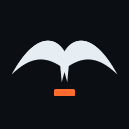

<p align="center">
  
</p>

<h1 align="center">Tern</h1>

<p align="center">A real Unix terminal for iPhone and iPad. Free, open source, no account, no server.</p>

Tern runs genuine Unix programs compiled for iOS: `ssh`, `scp`, `sftp`, `git` (through libgit2),
`vim`, `curl`, `tar`, `grep`, `sed`, `awk`, `find`, `jq`, `lua`, `make` and about a hundred more,
driven by a POSIX style shell with tab completion, history search, inline suggestions and syntax
highlighting. It works offline, starts instantly, and treats your phone's keyboard as a first
class citizen.

> Status: version 1.0 is being prepared for the App Store. Until then, build it yourself in a few
> minutes (see below) or install through TestFlight once the link is published here.

## Why Tern

* **Native, not emulated.** Commands are iOS binaries from the [ios_system](https://github.com/holzschu/ios_system)
  ecosystem, the same foundation a-Shell uses. No x86 emulator, no Linux kernel, no battery drain.
* **A shell that feels like home.** `tsh` understands the POSIX shell plus the bash features people
  actually use: pipelines, redirections, `if`/`for`/`while`/`case`, functions, `$(...)`, `$((...))`,
  globbing, heredocs, `[[ ]]`, brace expansion. `sh script.sh` runs scripts with a real dash.
* **A keyboard made for a shell.** A bar with esc, tab, ctrl, alt, arrows and the symbols you need,
  with latching modifiers and press and hold repeat. Hardware keyboards get every shortcut.
* **Fish style editing.** Tab completion with candidate lists, Ctrl-R history search, grey inline
  suggestions, syntax highlighting as you type, git branch in the prompt.
* **Light and dark, properly.** Eleven terminal palettes, three fonts, a chrome that follows the
  system or your choice.
* **Files you can reach.** Home is the app's Documents folder, visible in the Files app.
* **SSH without friction.** Generate and copy keys, keep hosts in `~/.ssh/config`, connect in one tap.
* **Nothing phones home.** No analytics, no accounts, no network use except what you run.

## Screenshots

Screenshots land in `docs/screenshots/` once the first TestFlight build ships.

## Build it

Requirements: macOS with Xcode 16 or newer. The project targets iOS 17 and later.

```sh
git clone https://github.com/FLoWIsMe/linux-for-ios.git
cd linux-for-ios
scripts/fetch-toolchain.sh      # downloads the prebuilt command frameworks (about 100 MB, verified by SHA-256)
open Tern.xcodeproj             # select your team in Signing, pick a device or simulator, run
```

`Config/Shared.xcconfig` holds the team and bundle identifier. Create `Config/Local.xcconfig`
(git ignored) to override them for your own account.

If you change `project.yml`, regenerate the project with [XcodeGen](https://github.com/yonaskolb/XcodeGen):
`brew install xcodegen && xcodegen generate`.

### Apple silicon simulators

Most of the toolchain has arm64 Simulator slices. `vim`, `lg2`, `dash`, `jq`, `xxd` and `make` currently
ship only x86_64 Simulator slices upstream, so on an Apple silicon Mac those commands are skipped in
Simulator builds (the app tells you so if you type them). Device builds always include everything.

## Repository layout

| Path | Contents |
| --- | --- |
| `Tern/` | The iOS app (SwiftUI, UIKit, SwiftTerm) |
| `Packages/TernCore/` | The shell interpreter, line editor, completion, history and session, pure Swift, tested on macOS and Linux |
| `Toolchain/` | Manifest of every prebuilt framework with URLs and checksums; the downloaded frameworks live in `Toolchain/frameworks` |
| `scripts/` | Toolchain download and embedding, screenshot export, release helpers |
| `docs/` | Architecture, shell reference, publishing guide, privacy policy |
| `fastlane/` | App Store metadata |

## Running the tests

```sh
cd Packages/TernCore && swift test          # interpreter, line editor and session, runs on macOS and Linux
xcodebuild test -project Tern.xcodeproj -scheme Tern \
  -destination 'platform=iOS Simulator,name=iPhone 18 Pro Max'   # app unit tests and UI tests
```

Every piece of logic is designed to be exercised without a human: the core package runs the
interpreter against real coreutils, and the UI tests drive the app end to end and capture the
screenshots used for the store listing.

## Roadmap

* Python with pip (the ios_system ecosystem has it; it adds about 150 MB)
* Rebuilt arm64 Simulator slices for vim, lg2 and dash
* Multiple windows on iPad and Stage Manager
* Shortcuts actions (run a command, get its output)
* A Linux emulation mode for people who need arbitrary binaries, if a maintainable engine appears

## Contributing

Pull requests are welcome. Read `docs/ARCHITECTURE.md` first, keep the core package free of
UIKit, and add tests with every change. Please do not use em dashes in code or docs.

## License

MIT for everything in this repository. Tern ships binaries from other open source projects under
their own licenses; the complete list is in `THIRD_PARTY_LICENSES.md`.
